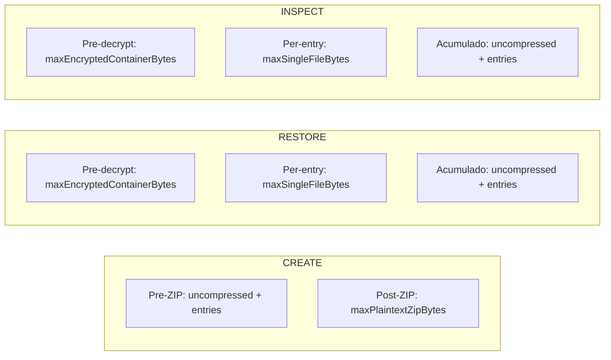

# 02 — Especificación Técnica

Especificación del formato contenedor GGBK V1, criptografía, límites de tamaño y whitelist de preferencias.

**Fuentes de referencia:**
- [`backup_crypto_service.dart`](../../lib/core/services/backup_crypto_service.dart)
- [`backup_v1_limits.dart`](../../lib/core/constants/backup_v1_limits.dart)
- [`backup_preferences_service.dart`](../../lib/core/services/backup_preferences_service.dart)

---

## 1. Formato Contenedor GGBK V1

El archivo `.gestorbackup` es un contenedor binario que encapsula un payload ZIP cifrado. El formato se denomina **GGBK** (Gestor Gastos Backup) versión 1.

### 1.1 Layout binario

```
Offset       Tamaño          Campo               Descripción
─────────    ──────          ─────               ───────────
0            4 bytes         MAGIC               "GGBK" (ASCII: 0x47 0x47 0x42 0x4B)
4            4 bytes         FORMAT_VERSION      UInt32 Big-Endian = 1
8            4 bytes         HEADER_LENGTH (H)   UInt32 Big-Endian
12           H bytes         HEADER_JSON         Parámetros criptográficos (UTF-8)
12+H         4 bytes         MAC_LENGTH (M)      UInt32 Big-Endian = 16
16+H         M bytes         MAC                 Authentication Tag (AES-GCM)
16+H+M       4 bytes         CIPHERTEXT_LEN (C)  UInt32 Big-Endian
20+H+M       C bytes         CIPHERTEXT          Payload cifrado
```

**Tamaño total del archivo:** `20 + H + M + C` bytes.

### 1.2 Header JSON

El header es un objeto JSON UTF-8 de longitud variable que contiene los parámetros necesarios para el descifrado:

```json
{
  "formatVersion": 1,
  "kdf": "PBKDF2-HMAC-SHA256",
  "iterations": 600000,
  "salt": "<base64, 16 bytes decodificados>",
  "cipher": "AES-256-GCM",
  "nonce": "<base64, 12 bytes decodificados>"
}
```

El header JSON se utiliza como **AAD** (Additional Authenticated Data) del cifrado AES-GCM. Cualquier modificación del header invalida la autenticación del contenedor.

### 1.3 Validaciones del parser (decrypt)

| Campo | Validación |
|---|---|
| `MAGIC` | Debe ser exactamente `"GGBK"`. |
| `FORMAT_VERSION` | Debe ser `1`. Otros valores producen `BackupVersionException`. |
| `HEADER_LENGTH` | Máximo 10 MiB (protección contra OOM). |
| `kdf` | Debe ser `"PBKDF2-HMAC-SHA256"`. |
| `cipher` | Debe ser `"AES-256-GCM"`. |
| `iterations` | Rango aceptado: [100 000, 2 000 000]. |
| `salt` | Debe decodificar a exactamente 16 bytes. |
| `nonce` | Debe decodificar a exactamente 12 bytes. |
| `MAC_LENGTH` | Debe ser 16 (fijo para AES-128 tag de AES-GCM). |
| Truncamientos | Cada sección verifica que el buffer contenga bytes suficientes antes de leer. |

---

## 2. Criptografía

### 2.1 Derivación de clave

| Parámetro | Valor |
|---|---|
| Algoritmo | PBKDF2-HMAC-SHA256 |
| Iteraciones (default) | 600 000 |
| Rango aceptado | [100 000 – 2 000 000] |
| Longitud de clave | 256 bits (32 bytes) |
| Salt | 16 bytes generados con `Random.secure()` |

La derivación se implementa mediante el paquete `cryptography` de Dart (`Pbkdf2` con `Hmac.sha256()`).

### 2.2 Cifrado simétrico

| Parámetro | Valor |
|---|---|
| Algoritmo | AES-256-GCM |
| Nonce | 12 bytes generados con `Random.secure()` |
| AAD | Bytes UTF-8 del Header JSON |
| Authentication Tag | 16 bytes |

La implementación utiliza `AesGcm.with256bits()` del paquete `cryptography`.

### 2.3 Propiedades de seguridad

- **Salt y nonce únicos por backup.** Dos backups del mismo contenido con la misma contraseña producen archivos binarios diferentes.
- **Autenticación del header.** El header JSON es AAD de AES-GCM, lo que previene modificaciones silenciosas de los parámetros criptográficos.
- **Sin almacenamiento de contraseña.** La contraseña no se guarda en ningún lugar. No existe mecanismo de recuperación.

### 2.4 Errores de autenticación

| Situación | Excepción |
|---|---|
| Contraseña incorrecta | `BackupAuthenticationException` |
| MAC modificado | `BackupAuthenticationException` |
| Header modificado (AEAD reject) | `BackupAuthenticationException` |
| Ciphertext modificado | `BackupAuthenticationException` |
| Magic inválido | `BackupFormatException` |
| Versión desconocida | `BackupVersionException` |

---

## 3. Contenido del Payload (ZIP)

El ciphertext, una vez descifrado, es un archivo ZIP que contiene:

| Archivo | Obligatorio | Descripción |
|---|---|---|
| `manifest.json` | Sí | Metadatos del backup (versión, fecha, componentes). |
| `gestor_gastos.db` | Sí | Snapshot de la base de datos SQLite. |
| `preferences.json` | Sí | Preferencias exportadas de la whitelist. |
| `attachments/transactions/<archivo>` | No | Imágenes adjuntas a transacciones. |

### 3.1 Manifest

```json
{
  "payloadVersion": 1,
  "appVersion": "1.0.0+1",
  "databaseSchemaVersion": 24,
  "createdAt": "2026-10-10T03:30:00.000Z",
  "components": ["database", "preferences", "transactionAttachments"],
  "transactionAttachmentsIncluded": 0,
  "transactionAttachmentsMissing": 0
}
```

### 3.2 Whitelist de entradas ZIP

Solo se aceptan archivos que cumplan una de estas condiciones:

- Nombre exacto: `manifest.json`, `gestor_gastos.db` o `preferences.json`.
- Ruta con prefijo `attachments/transactions/` sin subdirectorios adicionales.

Cualquier otra entrada produce `BackupFormatException`. Las rutas con `..`, `/` inicial o `\` inicial se rechazan como intento de path traversal (`ZipSecurityException`).

---

## 4. Whitelist de Preferencias

Solo las siguientes 7 claves se exportan e importan. Todas las demás se ignoran.

| Clave | Tipo | Propósito |
|---|---|---|
| `USER_NAME` | `String` | Nombre del usuario mostrado en la interfaz. |
| `CURRENCY` | `String` | Moneda base seleccionada (ej. `"PEN"`). |
| `BUDGET_LIMIT` | `double` | Límite de presupuesto mensual configurado. |
| `USER_AVATAR` | `String` | Identificador del avatar seleccionado. |
| `THEME_MODE` | `bool` | Preferencia de tema oscuro/claro. |
| `EXCHANGE_RATES` | `String` | Tasas de cambio almacenadas como JSON serializado. |
| `LAST_KNOWN_TIMEZONE` | `String` | Zona horaria de referencia para cálculos temporales. |

### 4.1 Claves excluidas

| Clave | Motivo de exclusión |
|---|---|
| `FIRST_TIME` | Estado interno del flujo de bienvenida. No es portable. |
| `PROFILE_IMAGE_PATH` | Ruta absoluta local. No es portable entre dispositivos. |
| `ENABLE_NOTIFICATIONS` | Permiso del sistema operativo. No es portable. |
| `SCHEDULER_MIGRATION_VERSION` | Estado interno del scheduler de notificaciones. |
| Credenciales (PIN hash, salt) | Datos de seguridad local. No se exportan por diseño. |

### 4.2 Política de restauración de preferencias

| Caso | Comportamiento |
|---|---|
| Clave presente en backup y en whitelist | Se restaura el valor del backup. |
| Clave ausente en backup pero presente en dispositivo | Se conserva el valor actual del dispositivo. |
| Clave presente en backup pero fuera de whitelist | Se ignora silenciosamente. |
| Valor nulo | Se ignora (se conserva el valor actual). |
| Tipo incorrecto | Se ignora esa clave específica. No interrumpe el proceso. |
| `double` recibido como `int` | Conversión automática (`int.toDouble()`). |

---

## 5. Límites de Tamaño

Definidos en `BackupV1Limits` (`lib/core/constants/backup_v1_limits.dart`):

| Constante | Valor | Aplicado en |
|---|---|---|
| `maxPlaintextZipBytes` | 50 MiB (52 428 800 bytes) | CREATE: tras generar el ZIP |
| `maxEncryptedContainerBytes` | 52 MiB (54 525 952 bytes) | RESTORE e Inspección: antes de descifrar |
| `maxUncompressedPayloadBytes` | 100 MiB (104 857 600 bytes) | CREATE, RESTORE e Inspección: suma acumulada |
| `maxSingleFileBytes` | 100 MiB (104 857 600 bytes) | RESTORE e Inspección: por entrada individual |
| `maxEntries` | 2 000 | CREATE, RESTORE e Inspección: conteo de entradas |

### 5.1 Puntos de validación



---

## 6. Herramienta de Inspección

El archivo [`tool/inspect_backup.dart`](../../tool/inspect_backup.dart) es una utilidad CLI de desarrollo que permite diagnosticar archivos `.gestorbackup` sin modificarlos.

### Uso

```bash
dart run tool/inspect_backup.dart ruta/al/archivo.gestorbackup
```

### Garantías

- Reutiliza `BackupCryptoService` productivo.
- Abre la base de datos SQLite en modo `readOnly`.
- No imprime contraseñas, balances, descripciones ni datos financieros. Solo conteos y metadatos estructurales.
- Limpia los archivos temporales descifrados en el bloque `finally`.
- Respeta los mismos límites de `BackupV1Limits`.
- Valida la whitelist de entradas ZIP con las mismas reglas que RESTORE.
