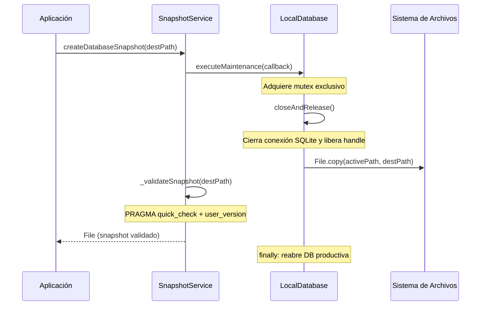
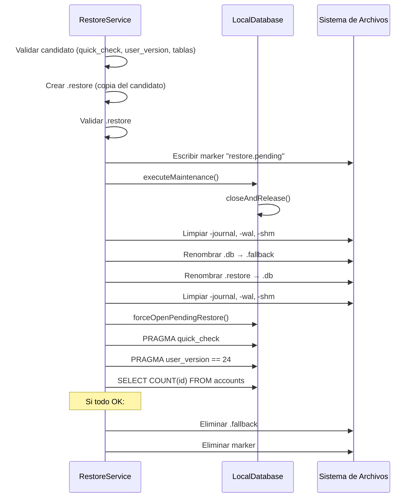
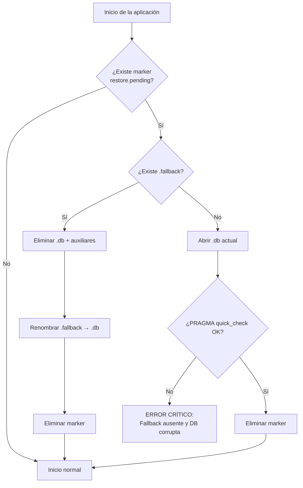

# 03 — Arquitectura y Recuperación

Documentación del pipeline de creación y restauración de backups, snapshot de la base de datos y mecanismo de crash recovery.

**Fuentes de referencia:**
- [`backup_creation_service_impl.dart`](../../lib/data/services/backup_creation_service_impl.dart)
- [`backup_restore_service_impl.dart`](../../lib/data/services/backup_restore_service_impl.dart)
- [`snapshot_service.dart`](../../lib/core/services/snapshot_service.dart)
- [`restore_service.dart`](../../lib/core/services/restore_service.dart)
- [`database_helper.dart`](../../lib/core/services/database_helper.dart)

---

## 1. Visión General

```mermaid
flowchart TB
    subgraph CREATE["Pipeline CREATE"]
        S1["Snapshot DB"] --> S2["Copiar adjuntos"]
        S2 --> S3["Exportar preferencias"]
        S3 --> S4["Generar manifest"]
        S4 --> S5["Comprimir ZIP"]
        S5 --> S6["Cifrar GGBK V1"]
        S6 --> S7["Compartir archivo"]
    end

    subgraph RESTORE["Pipeline RESTORE"]
        R1["Leer contenedor"] --> R2["Descifrar"]
        R2 --> R3["Descomprimir ZIP"]
        R3 --> R4["Validar manifest + DB"]
        R4 --> R5["Swap DB con fallback"]
        R5 --> R6["Instalar adjuntos"]
        R6 --> R7["Restaurar preferencias"]
        R7 --> R8["Reinicio interno"]
    end
```

---

## 2. Pipeline CREATE

Implementado en `BackupCreationServiceImpl.generatePortableBackup()`.

### 2.1 Etapas

#### Etapa 0 — Limpieza de backups previos

Elimina archivos `.gestorbackup` residuales del directorio de documentos. Esto previene acumulación de backups temporales de sesiones anteriores.

#### Etapa 1 — Snapshot y adjuntos (ventana crítica con mutex)

Esta etapa ejecuta dentro de `_attachmentService.executeMaintenance()`, que adquiere un mutex exclusivo para garantizar consistencia entre la base de datos y los adjuntos:

1. **Snapshot de la base de datos** — `SnapshotService.createDatabaseSnapshot()` (ver [sección 3](#3-snapshot-sqlite)).
2. **Normalización de adjuntos** — Para cada transacción con `imagePath`:
   - Resuelve la ruta absoluta del archivo físico.
   - Si el archivo no existe, limpia la referencia en la copia snapshot (no en la DB productiva).
   - Si el archivo existe, lo copia al directorio de staging.
3. **Deduplicación** — Múltiples transacciones que referencian el mismo archivo físico comparten una única copia en el ZIP. Se elige la primera ruta canónica válida como referencia.

Una ruta es canónica si cumple: no es absoluta, no contiene `..`, comienza con `attachments/transactions/` y el nombre de archivo no contiene subdirectorios.

#### Etapa 2 — Preferencias

Exporta las 7 claves de la [whitelist](02_ESPECIFICACION_TECNICA.md#4-whitelist-de-preferencias) a `preferences.json`.

#### Etapa 3 — Manifest

Genera `manifest.json` con: versión del payload, versión de la app, versión del esquema SQLite (leída del snapshot con `PRAGMA user_version`), timestamp UTC, componentes incluidos y conteo de adjuntos.

#### Etapa 4 — Validación pre-ZIP

Verifica que la suma de todos los archivos a incluir no exceda `maxUncompressedPayloadBytes` (100 MiB) ni `maxEntries` (2 000) antes de iniciar la compresión.

#### Etapa 5 — Compresión ZIP

Genera el archivo ZIP con rutas POSIX normalizadas. Incluye: `gestor_gastos.db`, `preferences.json`, `manifest.json` y los adjuntos deduplicados.

#### Etapa 6 — Validación post-ZIP

Verifica que el tamaño del ZIP no exceda `maxPlaintextZipBytes` (50 MiB).

#### Etapa 7 — Cifrado

Cifra el ZIP con `BackupCryptoService.encrypt()` utilizando la contraseña del usuario.

#### Etapa 8 — Output atómico

Escribe el contenedor cifrado a un archivo temporal (`.gestorbackup.tmp`) y luego lo renombra al nombre final (`backup_<timestamp>.gestorbackup`). El rename es una operación atómica en el sistema de archivos.

#### Etapa 9 — Limpieza (finally)

Elimina el directorio de staging, el ZIP en texto plano y el archivo temporal, incluso si ocurrió un error.

### 2.2 Resultado

El método retorna `Either<Failure, BackupCreationResult>` con:
- Ruta del archivo final.
- Cantidad de adjuntos incluidos.
- Cantidad de adjuntos faltantes.
- Tamaño del archivo final en bytes.

---

## 3. Snapshot SQLite

Implementado en `SnapshotService.createDatabaseSnapshot()`.

### 3.1 Procedimiento

### 3.2 Journal mode

La aplicación **no establece explícitamente** `PRAGMA journal_mode` en su configuración (`_onConfigure` solo ejecuta `PRAGMA foreign_keys = ON`). El framework sqflite en Android utiliza `journal_mode = delete` por defecto.

El procedimiento de snapshot está diseñado asumiendo este comportamiento:

- Con `journal_mode = delete`, cerrar la conexión vuelca todos los cambios pendientes al archivo `.db` principal.
- No existen archivos `-wal` o `-shm` activos durante la copia, lo que hace segura la copia física directa.
- El crash recovery en `database_helper.dart` limpia archivos `-journal`, `-wal` y `-shm` por precaución.

> **Nota:** Si una versión futura de sqflite o Android cambiara el journal mode por defecto a WAL, el procedimiento de snapshot requeriría un `PRAGMA wal_checkpoint(TRUNCATE)` antes de la copia física. Actualmente esto no se ha observado como necesario en las pruebas realizadas (Galaxy A30s, Android 11).

### 3.3 Validación del snapshot

Tras la copia, se abre la base de datos copiada con `singleInstance: false` (para no interferir con la conexión principal) y se ejecutan:

1. `PRAGMA quick_check` — Verifica integridad estructural.
2. `PRAGMA user_version` — Verifica que la versión del esquema sea mayor que 0.

Si cualquiera falla, se lanza `BackupFormatException` y el snapshot se descarta.

### 3.4 Reapertura garantizada

En el bloque `finally`, el servicio reabre la base de datos productiva (`await _localDatabase.database`) para que la aplicación continúe funcionando, incluso si la copia o la validación fallaron.

---

## 4. Pipeline RESTORE

Implementado en `BackupRestoreServiceImpl.restorePortableBackup()`.

### 4.1 Validaciones previas al swap

| Validación | Momento | Excepción |
|---|---|---|
| Existencia del archivo | Inicio | `BackupException` |
| Tamaño ≤ `maxEncryptedContainerBytes` | Antes de leer bytes | `BackupTooLargeException` |
| Descifrado GGBK V1 | Tras lectura | `BackupAuthenticationException` / `BackupFormatException` |
| Entradas ZIP: path traversal | Descompresión | `ZipSecurityException` |
| Entradas ZIP: whitelist | Descompresión | `BackupFormatException` |
| Tamaño por archivo ≤ 100 MiB | Por entrada | `BackupTooLargeException` |
| Contenido descomprimido ≤ 100 MiB | Acumulado | `BackupTooLargeException` |
| Entradas ≤ 2 000 | Acumulado | `BackupTooLargeException` |
| `manifest.json` presente | Post-descompresión | `BackupFormatException` |
| `payloadVersion == 1` | Manifest | `BackupVersionException` |
| `user_version` coincide con manifest | Staging DB | `BackupFormatException` |
| Adjuntos referenciados existen en ZIP | Staging DB vs archivos | `BackupFormatException` |

### 4.2 Swap de base de datos

El swap se delega a `RestoreService.restoreDatabase()`, que implementa un protocolo de reemplazo seguro:

### 4.3 Rollback automático

Si el swap falla (quick_check, versión incorrecta o error de apertura):

1. Se cierra la conexión nueva.
2. Se elimina el archivo `.db` corrupto/inválido.
3. Se renombra `.fallback` de vuelta a `.db`.
4. Se lanza `RestoreFailedException`.

### 4.4 Instalación de adjuntos

Después del swap exitoso de la base de datos, dentro del mutex de `_attachmentService.executeMaintenance()`:

1. Para cada archivo en `attachments/transactions/` del staging:
   - Se copia a una ubicación temporal (`.tmp`).
   - Si ya existe un archivo con ese nombre, se reemplaza mediante rename atómico con respaldo temporal (`.old`).
   - Si el rename falla, se restaura el archivo anterior.
2. Si un adjunto individual falla, se limpia la referencia en la base de datos restaurada y se agrega una advertencia. El proceso no se interrumpe.

### 4.5 Restauración de preferencias

Posterior al swap e independiente del mutex:

1. Lee `preferences.json` del staging.
2. Invoca `BackupPreferencesService.restorePreferences()`.
3. Si la restauración falla, se agrega una advertencia pero no se interrumpe el proceso.

### 4.6 Limpieza final (finally)

Elimina el ZIP en texto plano y el directorio de staging completo.

---

## 5. Crash Recovery

Implementado en `LocalDatabase._crashRecoveryCheck()`, ejecutado automáticamente al iniciar la aplicación.

### 5.1 Detección

Al abrir la base de datos, el sistema verifica la existencia del archivo marker `gestor_gastos.restore.pending`.

### 5.2 Escenarios

| Marker | Fallback | Acción |
|---|---|---|
| No existe | — | Inicio normal. |
| Existe | Existe | **Rollback:** elimina `.db` y archivos auxiliares, renombra `.fallback` → `.db`, elimina marker. |
| Existe | No existe | **Validación:** abre `.db` actual, ejecuta `PRAGMA quick_check`. Si pasa, elimina marker. Si falla, lanza error crítico. |

### 5.3 Diagrama de decisión

---

## 6. Reinicio Interno

Tras una restauración exitosa, la aplicación debe reinicializarse para que los providers carguen los datos restaurados.

El flujo de reinicio utiliza `RestartWidget.restartApp()`:

1. Desmonta el árbol de widgets completo.
2. Reinicializa el contenedor de dependencias (GetIt).
3. Reconstruye el árbol desde la raíz.
4. **No navega a OnboardingPage** porque `FIRST_TIME` no se exporta ni se modifica.
5. Si hay PIN/biometría configurados, se muestra `LockScreen` antes de acceder al Dashboard.

---

## 7. Inyección de Dependencias

Los servicios de backup se registran en `injection_container.dart`:

| Servicio | Tipo de registro | Dependencias |
|---|---|---|
| `SnapshotService` | Factory | `LocalDatabase` |
| `RestoreService` | Factory | `LocalDatabase` |
| `BackupCryptoService` | Factory | — |
| `BackupPreferencesService` | Factory | `SharedPreferences` |
| `AttachmentStorageService` | Factory | — |
| `BackupCreationServiceImpl` | Factory | Snapshot, Preferences, Attachment, Crypto, AppInfo |
| `BackupRestoreServiceImpl` | Factory | Restore, Preferences, Attachment, Crypto, AppInfo |

Los servicios de creación y restauración aceptan overrides de límites en su constructor para facilitar testing con archivos pequeños.
