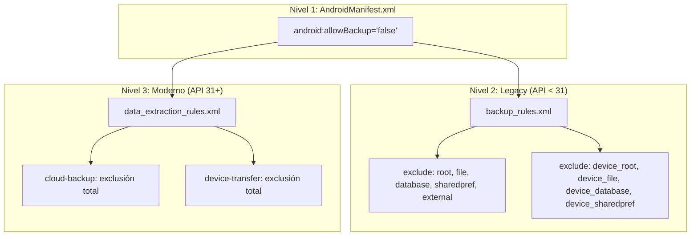

# 04 — Políticas Android y Testing

Documentación de las políticas de exclusión de backup de Android, la arquitectura de pruebas automatizadas y la verificación física del subsistema Backup V1.

**Fuentes de referencia:**
- [`AndroidManifest.xml`](../../android/app/src/main/AndroidManifest.xml)
- [`backup_rules.xml`](../../android/app/src/main/res/xml/backup_rules.xml)
- [`data_extraction_rules.xml`](../../android/app/src/main/res/xml/data_extraction_rules.xml)
- [`test/integration/backup_restore_e2e_test.dart`](../../test/integration/backup_restore_e2e_test.dart)
- [Manual de Verificación Física](../manual_verification_backup_restore.md)

---

## 1. Políticas de Android para Backup y Extracción de Datos

La aplicación implementa una estrategia de **Defensa en Profundidad (Defense in Depth)** para impedir que el sistema operativo o herramientas externas extraigan datos financieros no cifrados mediante los mecanismos automáticos de Android.



### 1.1 Declaración en AndroidManifest.xml

En [`android/app/src/main/AndroidManifest.xml`](../../android/app/src/main/AndroidManifest.xml#L17-L19):

```xml
<application
    android:label="gestor_gastos"
    android:name="${applicationName}"
    android:icon="@mipmap/ic_launcher"
    android:allowBackup="false"
    android:fullBackupContent="@xml/backup_rules"
    android:dataExtractionRules="@xml/data_extraction_rules">
```

| Atributo | Propósito | Comportamiento |
|---|---|---|
| `android:allowBackup="false"` | Interruptor principal del sistema | Deshabilita Android Auto Backup y `adb backup` a nivel global de la aplicación. |
| `android:fullBackupContent="@xml/backup_rules"` | Reglas legacy (Android 6.0 – 11, API 23–30) | Especifica exclusiones detalladas si el sistema operativo intenta un respaldo completo. |
| `android:dataExtractionRules="@xml/data_extraction_rules"` | Reglas modernas (Android 12+, API 31+) | Especifica exclusiones independientes para copia en la nube (`cloud-backup`) y migración dispositivo a dispositivo (`device-transfer`). |

### 1.2 Reglas para Android < 12 (`backup_rules.xml`)

En [`android/app/src/main/res/xml/backup_rules.xml`](../../android/app/src/main/res/xml/backup_rules.xml):

```xml
<?xml version="1.0" encoding="utf-8"?>
<full-backup-content>
    <!-- Almacenamiento estándar protegido por credenciales -->
    <exclude domain="root" path="." />
    <exclude domain="file" path="." />
    <exclude domain="database" path="." />
    <exclude domain="sharedpref" path="." />
    <exclude domain="external" path="." />

    <!-- Almacenamiento protegido del dispositivo (Direct Boot) -->
    <exclude domain="device_root" path="." />
    <exclude domain="device_file" path="." />
    <exclude domain="device_database" path="." />
    <exclude domain="device_sharedpref" path="." />
</full-backup-content>
```

Se excluyen explícitamente todos los dominios de almacenamiento del sistema operativo:
- **Almacenamiento protegido por credenciales:** Datos internos de la app (`root`), archivos (`file`), base de datos SQLite (`database`), preferencias (`sharedpref`) y almacenamiento externo (`external`).
- **Almacenamiento Direct Boot:** Archivos y bases de datos accesibles antes de desbloquear el dispositivo (`device_*`).

### 1.3 Reglas para Android 12+ (`data_extraction_rules.xml`)

En [`android/app/src/main/res/xml/data_extraction_rules.xml`](../../android/app/src/main/res/xml/data_extraction_rules.xml):

```xml
<?xml version="1.0" encoding="utf-8"?>
<data-extraction-rules>
    <cloud-backup>
        <!-- Almacenamiento estándar protegido por credenciales -->
        <exclude domain="root" path="." />
        <exclude domain="file" path="." />
        <exclude domain="database" path="." />
        <exclude domain="sharedpref" path="." />
        <exclude domain="external" path="." />

        <!-- Almacenamiento protegido del dispositivo (Direct Boot) -->
        <exclude domain="device_root" path="." />
        <exclude domain="device_file" path="." />
        <exclude domain="device_database" path="." />
        <exclude domain="device_sharedpref" path="." />
    </cloud-backup>
    <device-transfer>
        <!-- Almacenamiento estándar protegido por credenciales -->
        <exclude domain="root" path="." />
        <exclude domain="file" path="." />
        <exclude domain="database" path="." />
        <exclude domain="sharedpref" path="." />
        <exclude domain="external" path="." />

        <!-- Almacenamiento protegido del dispositivo (Direct Boot) -->
        <exclude domain="device_root" path="." />
        <exclude domain="device_file" path="." />
        <exclude domain="device_database" path="." />
        <exclude domain="device_sharedpref" path="." />
    </device-transfer>
</data-extraction-rules>
```

Tanto el respaldo en Google Drive (`cloud-backup`) como la transferencia directa por cable o Wi-Fi directo entre dispositivos (`device-transfer`) quedan excluidos de forma categórica para todos los dominios.

### 1.4 Justificación de Seguridad (Defensa en Profundidad)

> [!IMPORTANT]
> **¿Por qué configurar reglas XML si `allowBackup="false"` ya está presente?**
>
> 1. **Divergencia entre fabricantes:** Algunas capas de personalización de Android (ROMs de fabricantes o herramientas de migración propietarias) pueden interpretar `allowBackup="false"` únicamente para respaldos de Google Drive, pero omitirlo durante transferencias cableadas o herramientas OEM de sincronización.
> 2. **Actualizaciones de la plataforma:** Al declarar simultáneamente `backup_rules.xml` (API < 31) y `data_extraction_rules.xml` (API ≥ 31), la aplicación mantiene su política de exclusión inmutable ante cualquier versión del sistema operativo.
> 3. **Privacidad de datos financieros:** Los datos de Gestor de Gastos (saldos, movimientos, imágenes de comprobantes y PIN de seguridad) **nunca deben salir del dispositivo sin el consentimiento explícito del usuario y sin el cifrado simétrico AES-256-GCM** proporcionado por el formato GGBK V1.

---

## 2. Matriz de Pruebas Automatizadas

El subsistema de Backup V1 cuenta con cobertura en todas las capas arquitectónicas: pruebas unitarias, de integración, de interfaz de usuario y de validación de herramientas.

### 2.1 Suites de Pruebas

| Capa / Componente | Archivo de Prueba | Cobertura Principal |
|---|---|---|
| **Criptografía** | [`test/core/services/backup_crypto_service_test.dart`](../../test/core/services/backup_crypto_service_test.dart) | Cifrado y descifrado AES-256-GCM, derivación PBKDF2 (600 000 iteraciones), detección de datos corruptos, validación de AAD en header, límites de iteraciones. |
| **Preferencias** | [`test/core/services/backup_preferences_service_test.dart`](../../test/core/services/backup_preferences_service_test.dart) | Exportación e importación con whitelist estricta de 7 claves, tipos soportados (`String`, `double`, `bool`), omisión de claves fuera de la whitelist. |
| **Swap de Base de Datos** | [`test/core/services/restore_service_test.dart`](../../test/core/services/restore_service_test.dart) | Reemplazo atómico de base de datos con `.restore` y `.fallback`, crash recovery en arranque, verificación `quick_check` y `user_version`. |
| **Servicio de Creación** | [`test/data/services/backup_creation_service_impl_test.dart`](../../test/data/services/backup_creation_service_impl_test.dart) | Orquestación CREATE, empaquetado ZIP, generación de manifest V1, validación de límite de 50 MiB. |
| **Servicio de Restauración** | [`test/data/services/backup_restore_service_impl_test.dart`](../../test/data/services/backup_restore_service_impl_test.dart) | Orquestación RESTORE, validación de límites (52 MiB contenedor, 100 MiB por archivo, 2 000 entradas), verificación de hashes SHA-256 del manifest, rollback ante fallo. |
| **Inyección de Dependencias** | [`test/core/di/injection_container_backup_test.dart`](../../test/core/di/injection_container_backup_test.dart) | Registro en GetIt de casos de uso y servicios de backup, preservación del contenedor tras reinicio. |
| **Presentación (UI)** | [`test/presentation/features/settings/settings_backup_restore_test.dart`](../../test/presentation/features/settings/settings_backup_restore_test.dart) | ListTiles en Ajustes, validación de contraseña idéntica en diálogo modal, diálogo de confirmación destructiva, manejo de estados de carga y bloqueo de botones. |
| **Herramienta CLI** | [`test/tool/inspect_backup_test.dart`](../../test/tool/inspect_backup_test.dart) | Inspección de contenedores GGBK V1, visualización de header sin contraseña, descifrado con contraseña y verificación con flag `--verify`. |
| **Integración End-to-End** | [`test/integration/backup_restore_e2e_test.dart`](../../test/integration/backup_restore_e2e_test.dart) | 6 escenarios integrados de ciclo completo sobre base de datos SQLite real y sistema de archivos temporal. |

---

### 2.2 Escenarios End-to-End (`backup_restore_e2e_test.dart`)

Los tests E2E ejecutan el ciclo completo de la aplicación utilizando instancias reales de `LocalDatabase` (con `sqflite_common_ffi`), `SharedPreferences` mockeado y archivos físicos en disco:

#### `E2E-01: Ciclo completo financiero e integridad relacional`
- **Condición inicial (Estado A):** 2 cuentas (Principal S/ 1000 y Ahorros S/ 500), 3 transacciones (ingreso de sueldo S/ 2000, gasto de comida -S/ 300, transferencia entre cuentas S/ 400), meta de ahorro ("Vacaciones" S/ 5000), gasto recurrente ("Netflix" S/ 50) y presupuesto mensual (S/ 1800).
- **Acción:** Creación de backup cifrado → Mutación a Estado B (cuentas borradas/alteradas) → Restauración con contraseña.
- **Validación:** Saldos precisos tras restauración (Cuenta Principal: S/ 2300, Cuenta Ahorros: S/ 900), integridad relacional de transacciones, metas activas y presupuesto recuperado.

#### `E2E-02: Whitelist de preferencias se restaura y blacklist permanece local`
- **Origen:** 7 claves en whitelist (`USER_NAME`, `CURRENCY`, `BUDGET_LIMIT`, `USER_AVATAR`, `THEME_MODE`, `EXCHANGE_RATES`, `LAST_KNOWN_TIMEZONE`) y 4 claves en blacklist (`FIRST_TIME`, `ENABLE_NOTIFICATIONS`, `PROFILE_IMAGE_PATH`, `SCHEDULER_MIGRATION_VERSION`).
- **Destino previo:** Preferencias con valores distintos para ambas listas.
- **Validación:** Tras el restore, las 7 claves de la whitelist toman los valores del backup. Las 4 claves locales del dispositivo destino permanecen inalteradas con sus valores previos.

#### `E2E-03: Invariante de seguridad (PIN y Biometría no son alterados por restore)`
- **Origen:** `USER_NAME` = 'Origen Seguro', `SECURITY_PIN` = '1234', `ENABLE_BIOMETRICS` = `false`.
- **Destino:** `SECURITY_PIN` = '9999', `ENABLE_BIOMETRICS` = `true`.
- **Validación:** Tras restaurar el backup de origen, el dispositivo destino conserva su PIN local ('9999') y su configuración biométrica activa (`true`), actualizando únicamente el nombre de usuario ('Origen Seguro').

#### `E2E-04: Ciclo completo de Attachments reales con bytes verificados`
- **Origen:** 2 transacciones asociadas a imágenes físicas reales (JPG y PNG con encabezados binarios reales).
- **Acción:** Creación de backup → Borrado de las imágenes del disco y de los registros en SQLite → Restauración.
- **Validación:** Los archivos son extraídos en la estructura de almacenamiento de la app; sus rutas relativas coinciden y sus bytes binarios son exactamente idénticos al original (comparación byte a byte).

#### `E2E-05: Negativo: Contraseña incorrecta mantiene estado previo intacto`
- **Condición:** Dispositivo en Estado A.
- **Acción:** Intento de restauración utilizando una contraseña errónea.
- **Validación:** El descifrado AES-GCM falla por tag de autenticación inválido. La llamada retorna `Left(RestoreFailure)`. La base de datos y las preferencias locales conservan el 100% de su estado previo sin ninguna modificación.

#### `E2E-06: Negativo: Backup manipulado mantiene estado previo intacto`
- **Condición:** Dispositivo en Estado A.
- **Acción:** Modificación arbitraria de bytes intermedios en el archivo `.gestorbackup` (simulación de corrupción o ataque de manipulación).
- **Validación:** El MAC de AES-GCM detecta la manipulación inmediatamente. La restauración es abortada antes de tocar SQLite o las preferencias. El estado local permanece 100% intacto.

---

## 3. Verificación Manual en Dispositivo Físico

En las fases **13A-09** y **13A-10** se llevó a cabo un smoke test completo en hardware real Android.

**Detalle del entorno físico:**
- **Dispositivo:** Samsung Galaxy A30s (SM-A307G)
- **Sistema Operativo:** Android 11 (One UI Core 3.1, API 30)
- **Procesador:** Samsung Exynos 7904 (Octa-core 1.8 GHz)
- **Modo de compilación:** APK Debug instalada vía `adb install -r`
- **Seguridad local:** PIN numérico de 4 dígitos y huella dactilar activa

### 3.1 Resumen de la Matriz de Pruebas Físicas

| # | Prueba / Acción | Resultado Observado | Estado |
|---|---|---|---|
| **01** | Apertura de diálogo "Crear copia de seguridad" en Ajustes | Modal interactivo desplegado; botón "Aceptar" deshabilitado hasta coincidencia de campos. | **PASS** |
| **02** | Contraseñas discrepantes | Mensaje interactivo de error visible; acción bloqueada. | **PASS** |
| **03** | Creación con contraseñas idénticas | Indicador de progreso visible (~14.8s total, ~13.9s en PBKDF2); apertura limpia de ShareSheet de Android. | **PASS** |
| **04** | Cancelación del ShareSheet del sistema | Regreso a la app sin bloqueos ni errores. | **PASS** |
| **05** | Guardado de backup en Google Drive | Archivo `.gestorbackup` guardado correctamente (`estado_a.gestorbackup`). Inspección confirmó formato GGBK V1 íntegro. | **PASS** |
| **05b** | Mutación a Estado B | Creación y modificación de movimientos para divergir del Estado A. | **PASS** |
| **06** | Apertura de "Restaurar copia de seguridad" | Selector de archivos del sistema nativo abierto con filtro `.gestorbackup`. | **PASS** |
| **07** | Cancelación en el selector de archivos | Regreso limpio a Ajustes sin alterar Estado B. | **PASS** |
| **08** | Selección de archivo `.gestorbackup` | Diálogo modal solicitando contraseña desplegado inmediatamente. | **PASS** |
| **09** | Contraseña incorrecta en restauración | SnackBar informativo específico («La contraseña es incorrecta o el archivo no es válido»); Estado B intacto. | **PASS** |
| **10** | Contraseña correcta | Despliegue de advertencia destructiva alertando sobre sobrescritura. | **PASS** |
| **11** | Cancelación en advertencia destructiva | Diálogo cerrado sin ejecutar restauración; Estado B intacto. | **PASS** |
| **12** | Confirmación en advertencia destructiva | Botones deshabilitados, texto informativo («Descifrando y restaurando datos...»), spinner activo, `PopScope` bloqueando salida. | **PASS** |
| **13** | Reinicio seguro y recuperación de datos | `RestartWidget` desmonta el árbol; GetIt reinicializado; **no se navega a Onboarding**; datos de Estado A recuperados fielmente. | **PASS** |
| **14** | Cierre y reapertura de la app | Pantalla de bloqueo solicita PIN o huella dactilar local sin verse afectada por la restauración. | **PASS** |
| **15** | Comprobación de fugas visuales | Sin renderizado previo del Dashboard financiero antes de autenticar credenciales locales. | **PASS** |

### 3.2 Escenarios no ejecutados físicamente (NOT TESTED)

Los siguientes escenarios no fueron ejecutados en hardware físico en la sesión de prueba y permanecen formalmente catalogados como **NOT TESTED** a nivel de dispositivo real:

| Escenario | Estado Físico | Motivo en sesión física | Cobertura en pruebas automatizadas |
|---|---|---|---|
| **Restauración física de adjuntos/imágenes** | **NOT TESTED** | El backup de prueba física (`estado_a.gestorbackup`) no contenía archivos adjuntos en esa sesión. | Cubierto por `E2E-04` a nivel lógico con verificación byte a byte de imágenes. No sustituye la prueba física con cámara/galería. |
| **Ciclo de vida (Lifecycle background → foreground)** | **NOT TESTED** | No se minimizó ni restauró la aplicación con diálogos de backup o advertencias destructivas abiertas. | Cubierto por diseño de modales y aislamiento de estado en widgets. Pendiente de verificación física de retención de foco y memoria. |
| **Validación física con `bmgr` (adb)** | **NOT TESTED** | No se forzaron comandos de Android Backup Manager (`adb shell bmgr run` / `backupnow`) para auditar la respuesta del daemon del SO ante las reglas de exclusión. | Respaldado estáticamente por la configuración de `AndroidManifest.xml`, `backup_rules.xml` y `data_extraction_rules.xml`. |

> [!WARNING]
> Las pruebas automatizadas (unitarias, integración y suites E2E) validan exhaustivamente la lógica de negocio, la criptografía y la consistencia relacional de SQLite, pero **no equivalen a pruebas físicas en hardware Android**. Los escenarios anteriores se mantienen registrados para su posterior verificación en hardware.

---

## 4. Mejoras Pendientes y Backlog Post-Estabilización

Las siguientes mejoras quedaron registradas tras las pruebas físicas para abordarse en fases posteriores, **sin modificar el formato contenedor GGBK V1 ni la compatibilidad criptográfica**:

1. **Derivación PBKDF2 en Isolate secundario (`Isolate.run`):**
   - *Situación actual:* En procesadores de gama de entrada (Exynos 7904), las 600 000 iteraciones toman ~13.9 s en el hilo principal de Dart, congelando la animación del spinner circular.
   - *Mejora:* Delegar el cómputo de PBKDF2 a un isolate en segundo plano conservando las 600 000 iteraciones, lo que mantendrá las animaciones a 60 fps constantes.
2. **Medición de rendimiento en compilación Release/Profile:**
   - *Situación actual:* Los tiempos actuales (~14 s) corresponden a compilaciones Debug con verificaciones de VM y aserciones activas.
   - *Mejora:* Documentar benchmarks oficiales en modo Release (AOT), donde las operaciones de enteros y hashing son sustancialmente más rápidas.
3. **Barra de progreso por etapas:**
   - *Situación actual:* Indicador circular indefinido durante toda la operación.
   - *Mejora:* Barra lineal o textos secuenciales que indiquen la fase («Preparando datos...», «Descifrando contenedor...», «Restaurando base de datos...»).
4. **Validación interactiva de contraseñas:**
   - *Situación actual:* El aviso "Las contraseñas no coinciden" se muestra desde que se ingresa el primer carácter en el campo principal si el campo de confirmación está vacío.
   - *Mejora:* Mostrar la discrepancia únicamente cuando el usuario haya enfocado o ingresado texto en el segundo campo.
5. **Visibilidad del SnackBar de éxito en CREATE:**
   - *Situación actual:* `Share.shareXFiles` despliega de inmediato la hoja nativa del sistema, cubriendo el SnackBar de 4 segundos antes de que el usuario termine de guardar el archivo en Drive.
   - *Mejora:* Disparar la confirmación tras el retorno de la llamada o presentar un diálogo modal breve de confirmación.
6. **Suavizado de transiciones entre pantallas:**
   - *Situación actual:* El reinicio de la aplicación y el cierre de modales destructivos pueden sentirse bruscos en hardware modesto.
   - *Mejora:* Implementar transiciones suaves mediante `FadeTransition` con `PageRouteBuilder`.
